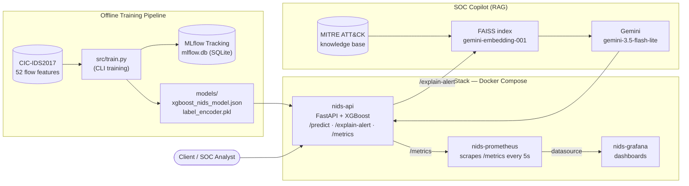

# 🛡️ Network Intrusion Detection System (NIDS) — MLOps Pipeline & AI SOC Copilot


A production-grade, end-to-end MLOps pipeline for **real-time network intrusion detection**, trained on the **CIC-IDS2017** dataset (52 network-flow features). It combines high-speed ML inference (**XGBoost + FastAPI**), experiment tracking (**MLflow**), real-time ML observability (**Prometheus + Grafana**), automated CI/CD (**GitHub Actions**), container orchestration (**Docker Compose**), and an AI-powered **SOC Copilot (RAG)** built with **LangChain, FAISS, and Google Gemini**, grounded in the **MITRE ATT&CK** framework.

---

## 📑 Table of Contents

1. [Executive Summary & Real-World Use Case](#-executive-summary--real-world-use-case)
2. [Architecture](#-architecture)
3. [Tech Stack](#-tech-stack)
4. [Key Engineering Highlights](#-key-engineering-highlights)
5. [Repository Structure](#-repository-structure)
6. [Quickstart (Docker Compose)](#-quickstart-docker-compose)
7. [API Usage Examples](#-api-usage-examples)
8. [Experiment Tracking (MLflow) & Testing](#-experiment-tracking-mlflow--testing)
9. [Monitoring & Screenshots](#-monitoring--screenshots)

---

## 🎯 Executive Summary & Real-World Use Case

Security Operations Center (SOC) analysts are flooded with alerts and spend much of their time triaging and writing incident reports. This project automates the first steps of that workflow:

1. **Network flow in** — a flow record (52 features) is sent to the `/predict` endpoint.
2. **XGBoost prediction** — the model classifies the flow (e.g., Normal, DDoS, Port Scanning) and returns a confidence score.
3. **Live observability** — prediction counts and confidence distributions are exported to **Prometheus** and visualized in **Grafana** in near real time.
4. **AI-assisted triage** — when an alert fires, `/explain-alert` uses a **RAG pipeline** over a MITRE ATT&CK knowledge base to generate an **incident report and remediation playbook**, grounded in the relevant technique (e.g., `T1498` for DDoS).

```text
Network Flow → XGBoost (/predict) → Prometheus/Grafana (live alert) → RAG (/explain-alert) → MITRE ATT&CK Incident Report & Playbook
```

---

## 🏗️ Architecture



---

## 🧰 Tech Stack

| Layer | Technologies |
|---|---|
| **Machine Learning & Data** | Python 3.12, XGBoost (native JSON export for GPU-to-CPU portability), Scikit-learn (`LabelEncoder` persisted via Joblib), Pandas, NumPy |
| **Experiment Tracking** | MLflow (local SQLite backend, `mlflow.db`) |
| **API & Validation** | FastAPI, Uvicorn, Pydantic (strict 52-feature validation; HTTP `422` on missing columns or NaN/Inf values) |
| **AI SOC Copilot (RAG)** | LangChain (LCEL), FAISS (`faiss-cpu`), Google Gemini (`gemini-embedding-001` for embeddings, `gemini-3.5-flash-lite` for generation), `python-dotenv` |
| **Knowledge Base** | MITRE ATT&CK — see coverage table below |
| **Monitoring & Observability** | Prometheus (`prometheus-fastapi-instrumentator`, `prometheus-client`) scraping `/metrics` every 5s, Grafana |
| **Infrastructure & CI/CD** | Docker (`python:3.12-slim` + `libgomp1`), Docker Compose (3-container stack), Pytest + HTTPX, GitHub Actions |

### MITRE ATT&CK Knowledge Base Coverage

| Traffic Class | MITRE Technique |
|---|---|
| Port Scanning | `T1046` |
| DDoS | `T1498` |
| DoS | `T1499` |
| Brute Force | `T1110` |
| Web Attack | `T1190` |
| Bots | `T1071` |
| Normal Traffic | — (baseline reference) |

---

## ⚙️ Key Engineering Highlights

- **Lazy-loaded RAG engine** — `src/api.py` initializes the RAG engine only on first use of `/explain-alert`. This lets the CI/CD unit tests run **without a `GOOGLE_API_KEY`**, keeping the pipeline fast, deterministic, and secret-free.
- **Custom Prometheus ML metrics** — beyond standard HTTP metrics, the API exposes model-level observability:

  | Metric | Type | Description |
  |---|---|---|
  | `nids_predictions_total` | Counter (label: `predicted_class`) | Number of predictions per predicted traffic class |
  | `nids_prediction_confidence` | Histogram | Distribution of model confidence scores |

- **Strict input validation** — Pydantic enforces all 52 features; missing columns or NaN/Inf values are rejected with HTTP `422` before reaching the model.
- **GPU-to-CPU portability** — the XGBoost model is exported in native JSON format, so a model trained on GPU can be served on a CPU-only container.
- **Security best practices** — the API key lives in a `.env` file that is injected at runtime via `docker-compose.yml` (`env_file`) and is excluded from both `.gitignore` and `.dockerignore`, so secrets never enter the repo or the image.
- **Automated CI** — GitHub Actions runs the Pytest suite and a Docker image build on every push/PR.
- **Reproducible experiments** — every training run is tracked in MLflow with a CLI-configurable set of hyperparameters.

---

## 📁 Repository Structure

```text
Network_Intrusion_Detection_System/
├── .github/workflows/ci.yml      # GitHub Actions (Pytest + Docker build)
├── models/
│   ├── xgboost_nids_model.json   # Trained XGBoost model (native JSON)
│   └── label_encoder.pkl         # Fitted LabelEncoder (Joblib)
├── src/
│   ├── api.py                    # FastAPI app (/predict, /explain-alert, /metrics)
│   ├── rag_engine.py             # LangChain + FAISS + Gemini MITRE ATT&CK RAG
│   └── train.py                  # Modular CLI training script with MLflow tracking
├── tests/
│   └── test_api.py               # Automated unit tests
├── Dockerfile
├── docker-compose.yml            # Orchestrates nids-api, nids-prometheus, nids-grafana
├── prometheus.yml                # Prometheus scrape configuration
├── requirements.txt
├── .dockerignore
└── .gitignore
```

---

## 🚀 Quickstart (Docker Compose)

### Prerequisites

- [Docker Desktop](https://www.docker.com/products/docker-desktop/)
- A **Google AI Studio API key** — get one at [aistudio.google.com](https://aistudio.google.com/)

### 1. Clone the repository

```bash
git clone https://github.com/Saad-Dairi/Network_Intrusion_Detection_System.git
cd Network_Intrusion_Detection_System
```

### 2. Create the `.env` file

```bash
echo "GOOGLE_API_KEY=your_key" > .env
```

### 3. Build and start the stack

```bash
docker compose up -d --build
```

### 4. Open the services

| Service | Container | URL | Notes |
|---|---|---|---|
| **FastAPI (Swagger UI)** | `nids-api` | http://127.0.0.1:8000/docs | Interactive API docs |
| **Prometheus** | `nids-prometheus` | http://127.0.0.1:9090/targets | Confirm the API target is `UP` |
| **Grafana** | `nids-grafana` | http://127.0.0.1:3000 | Default login: `admin` / `admin` |

**Grafana setup:** add a Prometheus data source with URL `http://nids-prometheus:9090`, then build panels on `nids_predictions_total` and `nids_prediction_confidence`.

### Stop the stack

```bash
docker compose down
```

---

## 📡 API Usage Examples

> The Swagger UI at `/docs` is the source of truth for the exact request/response schemas. The examples below are illustrative.

### `POST /predict`

Classifies a single network flow. The request body must contain **all 52 CIC-IDS2017 features** used in training; missing fields or NaN/Inf values return HTTP `422`.

**Request**

```bash
curl -X POST "http://127.0.0.1:8000/predict" \
  -H "Content-Type: application/json" \
  -d '{
    "<feature_1>": 0.0,
    "<feature_2>": 0.0,
    "...": "... all 52 features ..."
  }'
```

**Response (illustrative)**

```json
{
  "predicted_class": "DDoS",
  "confidence": 0.97
}
```

**Validation error (missing feature or NaN/Inf)**

```text
HTTP/1.1 422 Unprocessable Entity
```

### `POST /explain-alert`

Generates a MITRE ATT&CK–grounded incident report and remediation playbook for a detected alert, using the RAG pipeline (FAISS retrieval + Gemini generation).

**Request**

```bash
curl -X POST "http://127.0.0.1:8000/explain-alert" \
  -H "Content-Type: application/json" \
  -d '{"attack_type": "DDoS", "confidence": 0.97, "dest_port": 80}'
```

**Response (illustrative)**

```json
{
  "attack_type": "DDoS",
  "report": "Incident report and remediation playbook grounded in MITRE ATT&CK T1498 (Network Denial of Service)..."
}
```

> Requires `GOOGLE_API_KEY` to be set in `.env`.

### `GET /metrics`

Prometheus-formatted metrics, including the custom `nids_predictions_total` and `nids_prediction_confidence` series.

```bash
curl http://127.0.0.1:8000/metrics
```

---

## 🧪 Experiment Tracking (MLflow) & Testing

### Train a model (with MLflow tracking)

```bash
python src/train.py --sample-size 100000 --n-estimators 100 --max-depth 6 --lr 0.1
```

| Argument | Description |
|---|---|
| `--sample-size` | Number of rows sampled from CIC-IDS2017 for training |
| `--n-estimators` | Number of XGBoost boosting rounds |
| `--max-depth` | Maximum tree depth |
| `--lr` | Learning rate |

### Launch the MLflow UI

```bash
mlflow ui --backend-store-uri sqlite:///mlflow.db --port 5000
```

Then open http://127.0.0.1:5000 to compare runs, parameters, and metrics.

### Run the test suite

```bash
python -m pytest
```

Tests use Pytest + HTTPX and do **not** require a `GOOGLE_API_KEY`, thanks to the lazy-loaded RAG engine.

### Local development (without Docker)

```bash
python -m venv .venv
source .venv/bin/activate        # Windows: .venv\Scripts\activate
pip install -r requirements.txt
uvicorn src.api:app --reload --port 8000
```

---

## 📊 Monitoring & Screenshots

Prometheus scrapes the API's `/metrics` endpoint every **5 seconds**, and Grafana visualizes live ML behavior: prediction volume per attack class and the distribution of model confidence.


---

## 🙌 Acknowledgements

- [CIC-IDS2017 Dataset](https://www.unb.ca/cic/datasets/ids-2017.html) — Canadian Institute for Cybersecurity
- [MITRE ATT&CK®](https://attack.mitre.org/)
